# Hi 👋, I'm Dal (dalroot)

**Systems & Network Infrastructure Engineer**  
*Building low-latency network protocols, distributed proxies, and agentic systems.*

 

<!-- Metrics Badges -->

 

<!-- Social Badges -->
[-@dallsirvan-000000?style=for-the-badge&logo=x&logoColor=white)](https://x.com/dallsirvan)

 

---

### 🐍 Contribution Activity

  <picture>
    <source media="(prefers-color-scheme: dark)" srcset="https://raw.githubusercontent.com/dalroot/dalroot/output/github-contribution-grid-snake-dark.svg" />
    <source media="(prefers-color-scheme: light)" srcset="https://raw.githubusercontent.com/dalroot/dalroot/output/github-contribution-grid-snake.svg" />
    
  </picture>

 

---

### 💻 System & Engineering Profile

  

 

---

### ⚡ Selected Work & Current Focus

I'm a systems & network engineer working at the intersection of network protocols, user-space proxies, and developer automation. Most of my work revolves around engineering censorship-resilient infrastructure (`sing-box`, `TUN/TAP`, `WebSockets`) and open-source tools:

* 🚀 **[Antigravity Cleaner](https://github.com/tawroot/antigravity-cleaner)** *(350+ ★)* — Multi-platform environment sanitation and regional sanction bypasser for developer runtimes.
* ⚡ **[REX Protocol](https://github.com/dalroot/rex)** — Ultra-fast, zero-overhead infrastructure control protocol running over persistent WebSockets with sub-5ms deterministic latency.
* 🛡️ **[Hawal](https://github.com/dalroot/hawal)** & **[Roozaneh](https://github.com/dalroot/roozaneh-app)** — Censorship-resistant multiplexing cores and cross-platform clients utilizing transparent Layer-3 TUN routing via Android `VpnService`.
* 🤖 **[Agentic SEO](https://github.com/dalroot/agentic-seo)** & **[Meta Graph](https://github.com/dalroot/meta-graph-unofficial)** — Autonomous multi-agent skill suites and high-performance unofficial Graph API engines.

 

---

### 🛠️ Technical Stack & Toolchains

#### Languages

 

#### Platforms, Infrastructure & Tools

 

---

  Open protocols • Censorship-resilient networking • Pragmatic systems engineering

